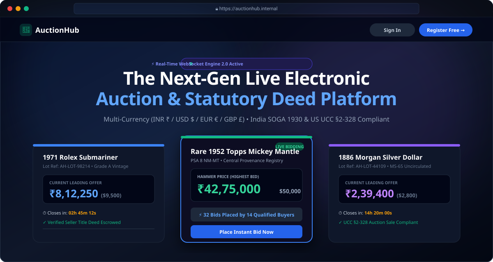
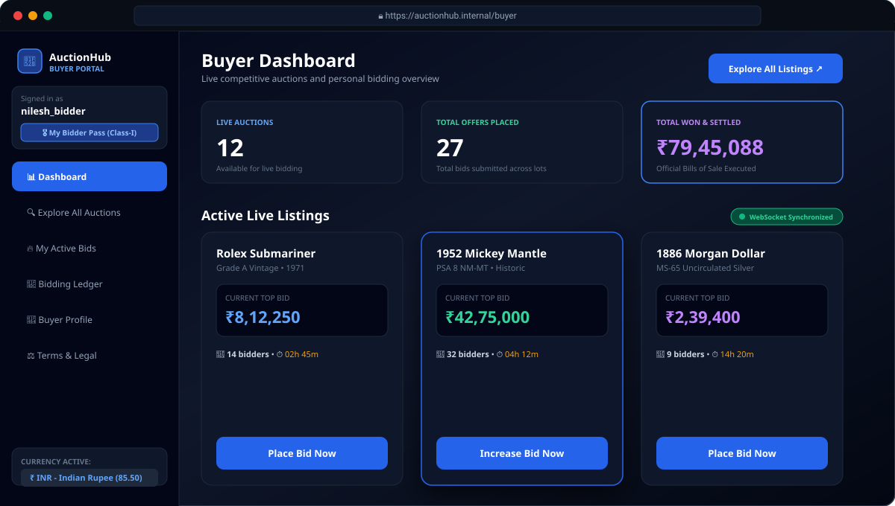
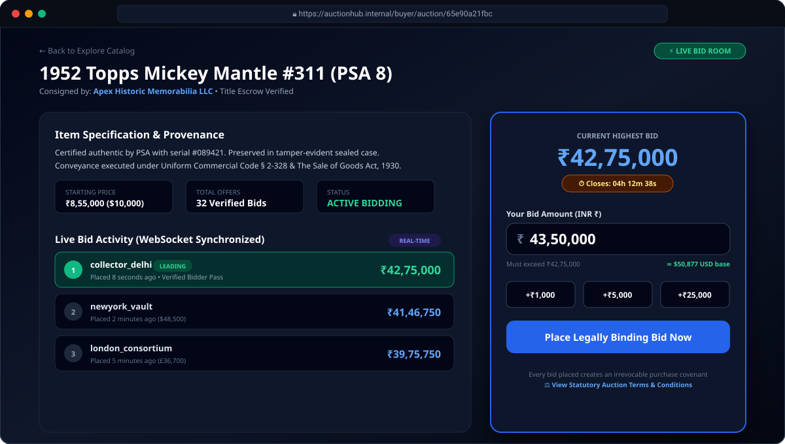
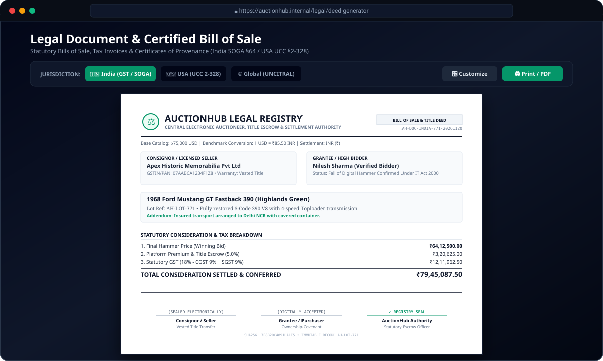
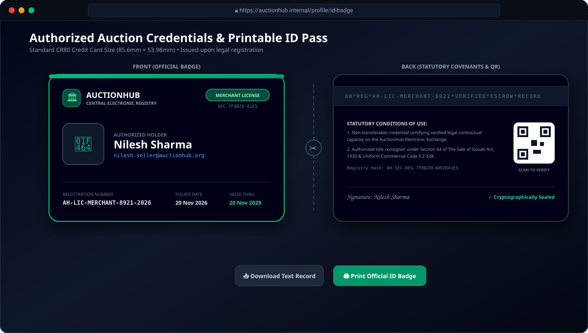
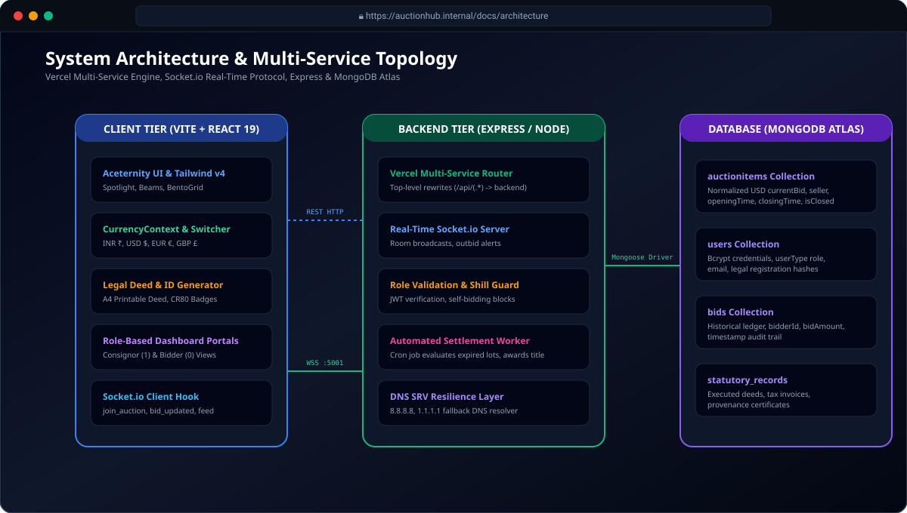

<div align="center">

# 🔨 AuctionHub — Next-Gen Real-Time Auction & Legal Deed Platform

[](https://nodejs.org/)
[](https://react.dev/)
[](https://tailwindcss.com/)
[](https://socket.io/)
[](https://expressjs.com/)
[](https://www.mongodb.com/atlas)
[](https://vercel.com/)
[](LICENSE)

<p align="center">
  <strong>High-concurrency live electronic bidding exchange engineered for high-value collectibles, luxury assets, and statutory commercial sales.</strong><br/>
  Featuring sub-millisecond WebSocket synchronization, international currency conflict resolution (INR ₹ / USD $ / EUR € / GBP £), automated final settlement workers, statutory legal document generation (India SOGA 1930 / USA UCC §2-328), and official CR80 printable identity credentials.
</p>

---



</div>

---

## 📑 Table of Contents

- [Executive Overview](#-executive-overview)
- [Key Features](#-key-features)
- [Visual Walkthrough & Screenshots](#-visual-walkthrough--screenshots)
  - [1. Consignor & Seller Dashboard](#1-consignor--seller-dashboard)
  - [2. Qualified Bidder Portal](#2-qualified-bidder-portal)
  - [3. Live WebSocket Bidding Room](#3-live-websocket-bidding-room)
  - [4. Statutory Legal Document & Bill of Sale Generator](#4-statutory-legal-document--bill-of-sale-generator)
  - [5. Official CR80 Printable Identity Credentials](#5-official-cr80-printable-identity-credentials)
  - [6. System Architecture & Topology](#6-system-architecture--topology)
- [Multi-Currency Conflict Resolution Engine](#-multi-currency-conflict-resolution-engine)
- [Statutory Compliance Framework](#-statutory-compliance-framework)
- [Technology Stack](#-technology-stack)
- [Project Directory Structure](#-project-directory-structure)
- [Getting Started & Local Development](#-getting-started--local-development)
  - [Prerequisites](#prerequisites)
  - [Installation](#installation)
  - [Environment Variables](#environment-variables)
  - [Running Locally](#running-locally)
- [Vercel Multi-Service Deployment Guide](#-vercel-multi-service-deployment-guide)
- [REST API Reference](#-rest-api-reference)
- [Verification & Automated Smoke Tests](#-verification--automated-smoke-tests)
- [Contributing & License](#-contributing--license)

---

## 🌟 Executive Overview

**AuctionHub** is a production-grade fullstack web application designed for transparent, tamper-evident online competitive bidding. Built with **React 19**, **Vite 6**, **Tailwind CSS v4**, and **Aceternity UI**, the platform unifies real-time event-driven architecture with formal statutory compliance required by auction contract laws across multiple jurisdictions.

### Core Value Propositions:
1. **Sub-Millisecond Real-Time Bidding**: Powered by Socket.io room broadcasts. When a user submits an offer, every connected bidder receives instant reactive state updates without polling.
2. **Conflict-Free Cross-Border Bidding**: Stores normalized monetary figures in base USD while offering real-time dynamic conversion and formatting in **Indian Rupees (INR ₹)**, **US Dollars (USD $)**, **Euros (EUR €)**, and **British Pounds (GBP £)**. An Indian buyer bidding in ₹ and an American buyer bidding in $ compete in the exact same room with live converted increments.
3. **Statutory Deed & Bill of Sale Generation**: Generates legally binding Bills of Sale, Tax Invoices, and Certificates of Provenance certified under **Section 64 of The Sale of Goods Act, 1930 (India)** and **Uniform Commercial Code UCC § 2-328 & § 2-316 (USA)** with customizable GSTIN/Tax ID, official seals, and digital audit hashes.
4. **Authorized CR80 Printable ID Badges**: Issues printable, wallet-sized (85.6mm × 53.98mm) credentials upon registration: *Grade-A Certified Consignor License* for sellers and *Verified Qualified Bidder Pass (Class-I)* for buyers, complete with QR code, security hashes, and cut-and-fold print templates.
5. **Shill-Bidding Prevention & Automated Settlement**: Server-enforced role access prevents consignors from bidding on their own lots, while an automated background worker continuously evaluates expired auctions, closes bidding, and declares verified winners.

---

## 🚀 Key Features

| Capability | Technical Implementation | Highlights |
| :--- | :--- | :--- |
| **Real-Time Bidding** | Socket.io WebSockets + Node.js HTTP Server | Instant price synchronization, outbid notifications, live bid ledger. |
| **Multi-Currency** | React Context (`CurrencyContext`) + Base USD Normalization | INR (₹85.50), USD ($1.00), EUR (€0.92), GBP (£0.79) seamless conversion. |
| **Legal Document Deed** | Statutory legal templates + `@media print` CSS | India GST (18%), SOGA 1930 §64, US UCC §2-328, UNCITRAL, digital signatures. |
| **Authorized ID Badges** | CR80 standard card design + Scissors fold guide | Security hash (`SEC-...`), magnetic strip simulation, verification QR code. |
| **Dual Portals** | Role-Based Access Control (`userType` 0=Buyer, 1=Seller) | Consignor inventory management, bidder tracking, and audited earnings ledgers. |
| **Mobile-First UX** | Aceternity UI, Spotlight, Background Beams, Tailwind v4 | Responsive sticky sidebars, thumb-friendly quick increment buttons. |
| **Serverless Deployment** | Vercel Multi-Service (`vercel.json`) | Unified domain routing `/api/(.*)` to Express and `/(.*)` to Vite frontend. |
| **DNS SRV Resilience** | Custom DNS resolver injection in Mongoose | Automatic Google (`8.8.8.8`) & Cloudflare (`1.1.1.1`) fallback for Windows SRV bug. |

---

## 📸 Visual Walkthrough & Screenshots

### 1. Consignor & Seller Dashboard
The seller portal gives consignors an intuitive overview of lifetime posted items, incoming bids, realized gross proceeds, and active inventory status.
- **Dynamic Currency Switcher**: View proceeds in ₹ INR, $ USD, € EUR, or £ GBP.
- **Quick Listing Action**: Instant navigation to publish new lots with legal warranties.
- **Consignor License Card Access**: One-click preview of official merchant credentials.


---

### 2. Qualified Bidder Portal
The buyer dashboard features a synchronized overview of live competitive listings, active personal offers, and total won & settled items.
- **WebSocket Status Indicator**: Live visual indicator verifying active room connection.
- **CardSpotlight Visuals**: Interactive glowing focus cards displaying highest offers and closing countdowns.
- **Instant Bidding Link**: Direct transition into competitive auction rooms.



---

### 3. Live WebSocket Bidding Room
The live bidding room is the high-energy core of the exchange:
- **Real-Time Bid Activity Ledger**: Chronological feed of leading offers with leading badges and timestamps.
- **Smart Currency-Scaled Increments**: In INR mode, offers scaled quick increment buttons (`+₹1,000`, `+₹5,000`, `+₹25,000`); in USD mode (`+$10`, `+$50`, `+$100`).
- **Base USD Settlement Transparency**: Live hint displays the exact base USD equivalent submitted to the server.
- **Minimalist Legal Terms Link**: Clear reminder that every placed offer constitutes a binding purchase covenant.



---

### 4. Statutory Legal Document & Bill of Sale Generator
When an auction concludes, buyers and sellers can generate certified legal instruments with full print customization:
- **Statutory Jurisdictions**: Select between **🇮🇳 India (GST / SOGA 1930 §64)**, **🇺🇸 USA (UCC §2-328)**, or **🌐 Global (UNCITRAL)**.
- **Customization Controls**: Override settlement currency, insert custom Taxpayer ID / GSTIN / PAN, add special addenda/conditions, and toggle seal watermark.
- **Tripartite Execution Block**: Electronic signatures for Consignor, Grantee, and AuctionHub Registry Escrow Officer.
- **Print & PDF Perfection**: Custom `@media print` rules strip web navigation and output high-contrast, border-accurate deeds suitable for framing or legal filing.



---

### 5. Official CR80 Printable Identity Credentials
Every registered participant receives an official, printable identity badge adhering to the **CR80 standard** (85.6mm × 53.98mm credit card dimensions):
- **Sellers**: *Licensed Consignor & Auction Merchant* (Grade-A Certified Title Consignor, 3-year renewable validity).
- **Buyers**: *Verified Qualified Bidder Pass* (Class-I, contractual capacity, lifetime validity).
- **Printable Cut & Fold Template**: Automatically renders Front and Back side-by-side with scissors cutting guidelines for a physical wallet badge.



---

### 6. System Architecture & Topology
Unified multi-service layout running within a single Vercel project with independent service builds and shared routing:



---

## 💱 Multi-Currency Conflict Resolution Engine

In traditional auction applications, supporting multiple currencies often introduces rounding conflicts, race conditions, or mismatched bid amounts. AuctionHub solves this through a **Normalized Base Currency Pipeline**:

```
[Buyer submits ₹43,50,000 INR]
              │
              ▼
[Client Converts: 4,350,000 / 85.50 = $50,877.19 USD]
              │
              ▼
[Server Persists: currentBid = 50877.19 USD]
              │
              ▼
[WebSocket Broadcasts: currentBid = 50877.19]
              │
       ┌──────┴─────────────────────────────────┐
       ▼                                        ▼
[Indian Bidder View]                   [US Bidder View]
₹50,877.19 * 85.50 = ₹43,50,000        $50,877.19 * 1.00 = $50,877.19
```

- **Base Normalization**: All numerical values (`startingBid`, `currentBid`, `bidAmount`, `totalEarnings`, `totalSpent`) are stored in base USD in MongoDB.
- **Benchmark Rates**:
  - `USD`: 1.00 (Base)
  - `INR`: 85.50 (Indian Rupee)
  - `EUR`: 0.92 (Euro)
  - `GBP`: 0.79 (British Pound)
- **Bid Validation**: Bids are validated against the active currency minimum before conversion, guaranteeing consistent auction increments.

---

## ⚖️ Statutory Compliance Framework

AuctionHub implements formal statutory auction legal principles:

### 1. Republic of India Jurisdiction
- **Statutory Act**: *The Sale of Goods Act, 1930 (Section 64)* & *Information Technology Act, 2000*.
- **Doctrine of the Fall of the Hammer**: Under SOGA §64(2), a sale by auction is complete when the auctioneer announces its completion by the fall of the hammer or other customary manner. In AuctionHub, the digital timer expiry or closure event serves as the statutory fall of the digital hammer.
- **Taxation Mandate**: 18% statutory GST (CGST 9% + SGST 9%) computed on the gross consideration and platform title escrow fee.

### 2. United States Jurisdiction
- **Statutory Act**: *Uniform Commercial Code (UCC) § 2-328 (Sale by Auction)* & *UCC § 2-316 (Exclusion of Warranties)*.
- **As-Is Conveyance**: Goods are conveyed as-is, where-is, with title transferred upon settled tender of consideration.
- **Taxation Mandate**: Standard state & municipal sales tax surcharge (6.5% benchmark).

### 3. International / Global Commercial Jurisdiction
- **Statutory Model**: *UNCITRAL Model Law on Electronic Commerce (1996)*.
- **Arbitration Covenants**: Dispute resolution governed by the Rules of Arbitration of the International Chamber of Commerce (ICC).

---

## 🛠️ Technology Stack

### Frontend Architecture
- **Framework**: [React 19](https://react.dev/) + [Vite v6](https://vitejs.dev/)
- **Styling**: [Tailwind CSS v4](https://tailwindcss.com/) + [Aceternity UI](https://ui.aceternity.com/)
- **Visual Components**: Spotlight, BackgroundBeams, CardSpotlight, BentoGrid, HoverBorderGradient
- **Icons**: [Lucide React](https://lucide.dev/)
- **Routing**: [React Router v7](https://reactrouter.com/)
- **HTTP Client**: [Axios](https://axios-http.com/) with automated Bearer token interceptor
- **Real-Time Client**: [Socket.io Client v4](https://socket.io/docs/v4/client-api/)
- **Notifications**: [React Hot Toast](https://react-hot-toast.com/)

### Backend Architecture
- **Runtime**: [Node.js v24](https://nodejs.org/)
- **Server Framework**: [Express.js v4](https://expressjs.com/)
- **Database Driver**: [Mongoose v8](https://mongoosejs.com/) + [MongoDB Atlas](https://www.mongodb.com/atlas)
- **Real-Time Engine**: [Socket.io Server v4](https://socket.io/) (HTTP + WebSocket server with room joining)
- **Security & Authentication**: [JSON Web Tokens (JWT)](https://jwt.io/) + [Bcrypt.js](https://github.com/dcodeIO/bcrypt.js)
- **Validation**: [Zod v3](https://zod.dev/)
- **Scheduled Settlement**: [Node-Cron](https://github.com/node-cron/node-cron) automated auction evaluation worker

---

## 📁 Project Directory Structure

```text
online-auction-platform/
├── backend/
│   ├── db/
│   │   └── dbconnect.js             # MongoDB Atlas connection with Google/Cloudflare DNS fallbacks
│   ├── middleware/
│   │   └── auth.js                  # JWT token verification and userType role protection
│   ├── models/
│   │   ├── auctionitem.js           # Auction schema (currentBid, bidders array, opening/closingTime)
│   │   └── user.js                  # User schema with bcrypt password hashing
│   ├── cron-job.js                  # Background worker closing expired auctions and awarding title
│   ├── server.js                    # Express + Socket.io server (port 5001, /api route mounting)
│   ├── verify.js                    # Automated smoke test suite (Bcrypt, JWT, route imports)
│   └── package.json
│
├── frontend/
│   ├── src/
│   │   ├── components/
│   │   │   ├── apiconnector.jsx     # Axios instance with auth token headers
│   │   │   ├── AuthorizedIdCardModal.jsx # CR80 printable license badge & bidder pass
│   │   │   ├── BuyerSidebar.jsx     # Sticky desktop & mobile drawer navigation for buyers
│   │   │   ├── CurrencySelector.jsx # Compact currency switcher dropdown
│   │   │   ├── LegalDocumentModal.jsx # Statutory Bill of Sale and Tax Invoice deed generator
│   │   │   ├── ProtectedRoute.jsx   # Role-based route guard
│   │   │   ├── SellerSidebar.jsx    # Sticky desktop & mobile drawer navigation for sellers
│   │   │   ├── TermsModal.jsx       # Minimalist 5-principle auction terms popup
│   │   │   └── ui/                  # Aceternity UI components (CardSpotlight, Beams, Spotlight)
│   │   ├── context/
│   │   │   ├── AuthContext.jsx      # Authentication & cookie session management
│   │   │   └── CurrencyContext.jsx  # Multi-currency state (INR, USD, EUR, GBP) & formatting
│   │   ├── pages/
│   │   │   ├── LandingPage.jsx      # Hero landing page with live WebSocket streaming badge
│   │   │   ├── LoginPage.jsx        # Secure sign in portal
│   │   │   ├── RegisterPage.jsx     # Registration with automated ID badge issuance
│   │   │   ├── TermsPage.jsx        # Dedicated statutory terms & conditions route
│   │   │   ├── buyers/              # Buyer dashboard, catalog, bid room, and bid history
│   │   │   └── sellers/             # Seller dashboard, auction publisher, active inventory, earnings
│   │   ├── App.jsx                  # Root router with providers
│   │   ├── index.css                # Tailwind v4 directives + custom @media print deed formatting
│   │   ├── main.jsx                 # React 19 root mount
│   │   └── socket.js                # Socket.io connection singleton
│   ├── vite.config.js               # Vite config with backend proxy to localhost:5001
│   └── package.json
│
├── docs/
│   └── screenshots/                 # High-fidelity SVG & PNG platform previews
│       ├── architecture-diagram.svg
│       ├── buyer-dashboard.svg
│       ├── hero-banner.svg
│       ├── id-card-pass.svg
│       ├── legal-deed-generator.svg
│       ├── live-auction-room.svg
│       └── seller-dashboard.svg
│
├── vercel.json                      # Vercel multi-service configuration & top-level routing
├── package.json                     # Monorepo root with concurrent dev scripts
└── README.md                        # Documentation & statutory handbook
```

---

## 💻 Getting Started & Local Development

### Prerequisites
- **Node.js**: v20.0.0 or higher (v24.x recommended)
- **npm**: v10.x or higher
- **MongoDB Atlas** cluster or a local MongoDB instance

### Installation
Clone the repository and install all dependencies across the monorepo root, backend, and frontend:

```bash
git clone https://github.com/your-username/online-auction-platform.git
cd online-auction-platform

# Install root, backend, and frontend dependencies in one command:
npm run install:all
```

### Environment Variables

#### Backend (`backend/.env`):
Create a file named `.env` inside the `backend/` directory:

```env
PORT=5001
MONGO_URI=mongodb+srv://<username>:<password>@cluster0.voxkjre.mongodb.net/auction?retryWrites=true&w=majority
JWT_SECRET=your_super_secret_jwt_key_here
CLIENT_URL=http://localhost:5173
```

#### Frontend (`frontend/.env`):
Create a file named `.env` inside the `frontend/` directory (optional for local dev as Vite proxies `/api` automatically):

```env
VITE_API_URL=http://localhost:5001/api
VITE_SOCKET_URL=http://localhost:5001
```

### Running Locally

To run both the Express backend and the Vite frontend simultaneously with colorized terminal logging:

```bash
npm run dev
```

- **Frontend Client**: Accessible at `http://localhost:5173`
- **Backend API Server**: Accessible at `http://localhost:5001`
- **WebSocket Protocol**: Connected at `ws://localhost:5001`

---

## ☁️ Vercel Multi-Service Deployment Guide

AuctionHub is pre-configured for **Vercel Multi-Service Deployment** via the root [`vercel.json`](vercel.json):

```json
{
  "$schema": "https://openapi.vercel.sh/vercel.json",
  "services": {
    "backend": {
      "root": "backend",
      "framework": "express"
    },
    "frontend": {
      "root": "frontend",
      "framework": "vite"
    }
  },
  "crons": [
    {
      "path": "/api/cron",
      "schedule": "*/5 * * * *"
    }
  ],
  "rewrites": [
    {
      "source": "/api/(.*)",
      "destination": {
        "service": "backend"
      }
    },
    {
      "source": "/(.*)",
      "destination": {
        "service": "frontend"
      }
    }
  ]
}
```

### Deployment Steps:
1. Push the repository to GitHub.
2. In the **Vercel Dashboard**, click **Add New Project** and select this repository.
3. Vercel automatically detects `vercel.json` and configures the `backend` (Express) and `frontend` (Vite) services.
4. Set the backend Environment Variables in the Vercel project settings (`MONGO_URI`, `JWT_SECRET`).
5. Click **Deploy**. Vercel provides a single unified domain routing `/api/*` to the backend serverless function and all other traffic to the optimized static frontend.

---

## 📡 REST API Reference

All protected endpoints require an `Authorization: Bearer <token>` header.

### Authentication Endpoints
| Method | Endpoint | Description | Access |
| :--- | :--- | :--- | :--- |
| `POST` | `/api/signup` | Registers new user and issues legal credentials | Public |
| `POST` | `/api/signin` | Authenticates user and returns JWT token | Public |
| `GET` | `/api/validate-token` | Verifies active JWT session and returns user role | Protected |
| `GET` | `/api/profile` | Fetches active user profile and registration details | Protected |
| `POST` | `/api/updateprofile` | Updates user display name and contact email | Protected |

### Auction Endpoints
| Method | Endpoint | Description | Access |
| :--- | :--- | :--- | :--- |
| `GET` | `/api/auctions` | Fetches all open and closed platform auctions | Public |
| `GET` | `/api/getauction/:id` | Fetches auction details, current bid, and bid history | Public |
| `POST` | `/api/auction` | Publishes new auction listing with starting bid | Consignor Only |
| `PUT` | `/api/auction/:id` | Modifies listing details (if no bids have been placed) | Consignor Only |
| `GET` | `/api/getAuctionsForSeller` | Fetches all auctions created by the authenticated seller | Consignor Only |
| `GET` | `/api/getauctionresult/:id` | Fetches final settled result, winner, and price | Protected |

### Bidding & Settlement Endpoints
| Method | Endpoint | Description | Access |
| :--- | :--- | :--- | :--- |
| `POST` | `/api/bid/:id` | Places competitive bid (must be > current highest bid) | Bidder Only |
| `GET` | `/api/getBidsForUser` | Fetches user's full bidding ledger (won, leading, outbid) | Bidder Only |
| `GET` | `/api/getauctionbidded` | Fetches active auctions where user has live bids | Bidder Only |
| `GET` | `/api/getearnings` | Fetches completed sales ledger and realized amounts | Consignor Only |
| `GET` | `/api/getstats` | Returns total earnings, items sold, and bids received | Consignor Only |
| `GET` | `/api/cron` | Vercel Cron endpoint triggering auction finalization | Public/Internal |

---

## 🧪 Verification & Automated Smoke Tests

The project includes an automated smoke test suite verifying core security modules, hashing algorithms, and route bindings:

```bash
npm test
```

### Sample Output:
```text
> online-auction-platform@1.0.0 test
> npm test --prefix backend

Testing backend core components...
✔ Bcrypt hashing works
✔ JWT generation and verification works
✔ All route modules load cleanly
Backend smoke tests passed successfully!
```

To run a production compilation of the frontend:
```bash
npm run build
```
Outputs an optimized production build in `frontend/dist/` with 0 errors.

---

## 👥 User Roles & Workflow

```text
       ┌────────────────────────┐
       │     New Participant     │
       └───────────┬────────────┘
                   │
         Choose Account Type
                   │
         ┌─────────┴─────────┐
         ▼                   ▼
   [Role: Buyer]       [Role: Seller]
         │                   │
  Receives Bidder     Receives Merchant
    Pass (CR80)         License (CR80)
         │                   │
         ▼                   ▼
  Browse Live Lots    Post Lot with Warranty
         │                   │
  Submit Live Bids    Monitor Offers & Bidders
         │                   │
         └─────────┬─────────┘
                   │
         Auction Concludes
         (Fall of Hammer)
                   │
                   ▼
       Execute Statutory Deed
        (India SOGA / US UCC)
```

---

## 📄 License & Legal Notice

This project is licensed under the **MIT License** — see the [LICENSE](LICENSE) file for details.

*Disclaimer: The statutory deeds and identity cards generated by AuctionHub demonstrate electronic commerce legal workflows under Section 64 of The Sale of Goods Act, 1930 and UCC § 2-328. For physical real-world high-value asset conveyance, consult qualified legal counsel in your respective jurisdiction.*

---

<div align="center">
  <sub>Built with care for the EY GDS Internship Program. Engineered with React 19, Socket.io, Tailwind CSS v4, and Node.js.</sub>
</div>
